 

<a href="#about">About</a> &nbsp;·&nbsp; <a href="#featured-projects">Projects</a> &nbsp;·&nbsp; <a href="#research-in-motion">Research</a> &nbsp;·&nbsp; <a href="#toolbox">Toolbox</a> &nbsp;·&nbsp; <a href="#on-github">GitHub</a> &nbsp;·&nbsp; <a href="#lets-connect">Contact</a>

## About

I am an **AI researcher and engineer** at the **Mohamed bin Zayed University of Artificial Intelligence (MBZUAI)**.
I work on perception that connects **what a model sees, what it reads and the 3D world both come from**: vision-language
models that ground language in images and scenes, and geometric methods that recover structure from images and video.
I care about systems that are accurate, and also **grounded, efficient and honest about their uncertainty**.

<table>
<tr>
<td width="25%" valign="top">

**🌐 Multimodal learning** 
Vision-language alignment · visual grounding · multimodal reasoning · efficient MLLMs

</td>
<td width="25%" valign="top">

**📐 3D vision** 
Structure from motion · camera pose · point clouds · open-vocabulary 3D scenes

</td>
<td width="25%" valign="top">

**🎥 Video understanding** 
Multi-object tracking · occlusion reasoning · re-identification · camera motion

</td>
<td width="25%" valign="top">

**🛡️ Trustworthy perception** 
Uncertainty estimation · calibration · explainability · medical imaging

</td>
</tr>
</table>

## Featured projects

## Research in motion

Language-driven queries over a reconstructed scene, the idea behind the open-vocabulary module in <a href="https://github.com/dangaura-tech/structura">Structura</a>. Illustrative animation.

## Toolbox

<table align="center">
<tr>
<td align="right"><b>AI &amp; vision</b></td>
<td>
</td>
</tr>
<tr>
<td align="right"><b>Languages</b></td>
<td></td>
</tr>
<tr>
<td align="right"><b>Systems</b></td>
<td></td>
</tr>
<tr>
<td align="right"><b>Tools</b></td>
<td></td>
</tr>
</table>

## On GitHub

## Let's connect

Happy to talk about multimodal models, 3D vision or research collaborations.

<i>Perception is not just recognising pixels. It is connecting what we see, what we say and the 3D world they come from.</i>

