---

### 🧑‍🔬 About me

I am an **AI researcher and engineer** at the **Mohamed bin Zayed University of Artificial
Intelligence (MBZUAI)** in Abu Dhabi, working on **computer vision that understands the world
across modalities and dimensions**. I study how models can **see, read and reason together**
(vision-language models and multimodal learning) and how they can recover and understand
**3D structure** from images and video. I care about systems that are not only accurate, but
also grounded, efficient and honest about their uncertainty.

- 🔭 **Research interests:** multimodal learning · vision-language models (VLMs / MLLMs) · 3D vision & reconstruction · video understanding & tracking · trustworthy perception
- 🧩 **Applications:** multimodal assistants, embodied & spatial AI, autonomous perception, medical imaging
- 🛠️ **Currently building:** a structure-from-motion & point-cloud toolkit (Structura) and occlusion-aware multi-object tracking (OccTrack)
- 🌱 **Exploring:** grounding VLMs in 3D scenes, open-vocabulary perception, efficient multimodal transformers
- 📫 **Reach me:** [dang.le@mbzuai.ac.ae](mailto:dang.le@mbzuai.ac.ae)

---

### 🚀 Featured projects

| Project | Area | Description |
|---|---|---|
| [**OccTrack**](https://github.com/dangaura-tech/occtrack) | Video Understanding · Tracking | Occlusion-aware multi-object tracking with camera-motion compensation, Re-ID memory and HOTA evaluation |
| [**BAU-Net**](https://github.com/dangaura-tech/bau-net) | Dense Prediction · Uncertainty | Boundary- and uncertainty-aware segmentation with a transformer bottleneck and uncertainty-guided point refinement (medical imaging) |

---

### 🧰 Tech stack

**Vision · Multimodal · 3D**

**Languages**

**Backend, systems & blockchain**

**Tools**

---

### 📊 GitHub stats

---

### 🏆 Achievements

Cards are rendered by a scheduled GitHub Action in this repository (<code>scripts/generate_cards.py</code>), so they never depend on rate-limited public services.

---

### 🐍 Contribution snake

<picture>
  <source media="(prefers-color-scheme: dark)" srcset="https://raw.githubusercontent.com/dangaura-tech/dangaura-tech/output/github-contribution-grid-snake-dark.svg" />
  <source media="(prefers-color-scheme: light)" srcset="https://raw.githubusercontent.com/dangaura-tech/dangaura-tech/output/github-contribution-grid-snake.svg" />
  
</picture>

---

*"Perception is not just recognising pixels - it is connecting what we see, what we say and the 3D world they come from."*

